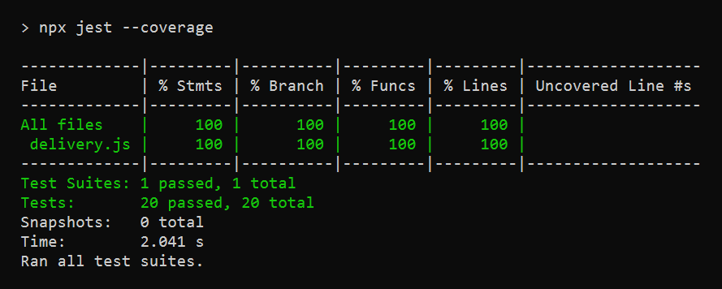

# APS - Testes do DeliveryExpress

APS de Teste de Software - UNIFAMETRO - Prof. Jonh Sousa

**Aluno:** Lôhan do Carmo Macedo Soares

## Sobre

A APS pedia pra escrever os 20 casos de teste (CT-01 ao CT-20) do DeliveryExpress no Jest e implementar as funções até todos os testes passarem.

- `delivery.js`: as 5 funções (autenticar, forcaSenha, podeLogar, calcularFrete e aplicarCupom)
- `delivery.test.js`: os 20 testes

## Como rodar

```
npm install
npm test
```

Pra ver a cobertura:

```
npx jest --coverage
```

## Resultado

20 testes passando e 100% de cobertura.


